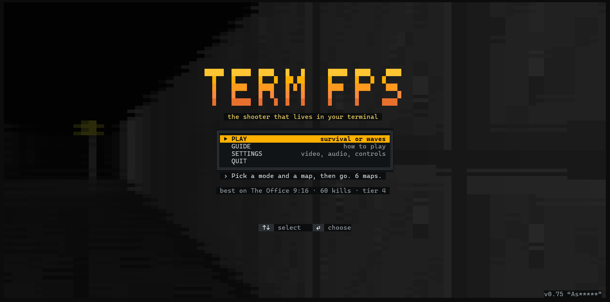

# termfps

A first-person shooter that runs entirely inside your terminal. A raycaster
draws the walls with half-block pixels (`▀`, two pixels per character cell),
so you get a retro 3D view with no GPU and no game client, from one small
binary.

It's a **single-player survival game**: six maps, five kinds of enemies that
keep coming and get smarter, three guns, pickups, hazards, an endless
survival mode and a 10-wave mode, stereo sound, an in-game guide, and saved
best scores. Multiplayer is planned later.

Current version: **v0.75 “As\*\*\*\*\*”**.



## Download

Get the latest test build from the
**[Releases page](https://github.com/BunnyPraneeth5/termfps/releases)**: a
`.zip` for Windows, a `.tar.gz` for Linux (64-bit Intel/AMD or ARM). Unpack
it and run `termfps.exe` (Windows, in Windows Terminal) or `./termfps`
(Linux). **Windows first:** that's where the game is made and played; the
Linux builds pass the same tests but haven't been played much yet. There's
no macOS build for now; you can build it yourself (below).

> **Windows may warn you about the download.** The exe isn't signed, so
> SmartScreen can show "Windows protected your PC": click **More info**, then
> **Run anyway**. Smart App Control may block it outright ("An Application
> Control policy has blocked this file"); see Troubleshooting below.

Found a bug, or have thoughts on the balance? Please use the
[feedback form](https://github.com/BunnyPraneeth5/termfps/issues/new?template=feedback.yml).

## Requirements

- **Go 1.27.1 or newer** to build.
- **A truecolor terminal.** Windows Terminal is the main target. VS Code's
  terminal also works.
- **At least 80x24 characters.** Smaller windows show "WINDOW TOO SMALL"
  until you resize; the game carries on by itself. About 120x40 looks best.
- **For sound:** speakers. On Linux, PulseAudio or PipeWire. Without them the
  game runs silently and the title screen says why.

> Half-block and mixed modes need a truecolor terminal and more bandwidth
> than plain text. Press `V` for shade-block or ASCII mode, which use plain
> characters and the terminal's own colors. Without truecolor, the game
> starts in ASCII. On a slow connection, Settings > Color threshold (4 or 8)
> roughly halves what half-block and mixed send, at a small cost in color
> detail.

## Build and run

To build it yourself instead of downloading, on Windows (PowerShell), from
the project folder:

```powershell
go build -o termfps.exe .
.\termfps.exe
```

Linux and macOS should work too (`go build -o termfps . && ./termfps`); the
code builds there and is checked on Linux by CI, but it hasn't been played
there much yet.

## Controls

In the game:

| Key / mouse | Action |
|---|---|
| `W` / `↑` | Move forward |
| `S` / `↓` | Move back |
| `A` / `D` | Strafe left / right |
| `Q` / `←` | Turn left |
| `E` / `→` | Turn right |
| `F` (hold) | Sprint: 1.6x speed for up to 4 seconds; stamina refills when you stop |
| `Space` / left click | Shoot (hold for 3 shots per second) |
| `R` / right click | Reload (the gun also reloads by itself when empty) |
| `1` `2` `3` / mouse wheel | Switch gun: pistol, shotgun, rifle (once you've found them) |
| `M` | Show / hide the minimap |
| `V` | Switch render mode: half-block → shade → ASCII → mixed |
| `Esc` | Pause |
| `Ctrl+C` | Quit right away, from anywhere |

In menus: `↑` / `↓` (or `W` / `S`) to select, `←` / `→` (or `A` / `D`) to
change a setting, `Enter` to choose, `Esc` to go back, `Tab` for the next
Settings tab. You can also click an item. Every screen shows its keys at
the bottom. There's no mouse-look: terminals can't capture the mouse. While the
game runs, the mouse belongs to the game, so selecting text in the terminal
needs Shift+drag in most terminals.

On Windows you can move and turn at the same time (the default `async` key
mode). See `-keys` below for other systems.

## Menus

- **Title:** the TERM FPS logo, a random tagline each start, and PLAY, GUIDE,
  SETTINGS, QUIT, with your best run and the version. Behind it the camera
  slowly wanders through one of your unlocked maps (Settings > Title
  background turns that off for slow terminals).
- **Play:** pick the mode and the map on one screen. **Survival** is
  endless; **Waves** is 10 waves with breaks between them (clear them all to
  win). The map list shows each map's size and how much of it you've
  explored, with a top-down picture of what you've seen, its doors and red
  barrels, and your bests there. Locked maps say what opens them.
- **Pause** (`Esc` in the game): a card over the frozen game with your time,
  kills, tier and HP and how far the next tier is (in waves mode, the wave),
  then Resume, Restart, Guide, Settings, Quit to menu (the run still counts).
- **Guide** (from the title or the pause card), in a panel that grows with
  the window up to 100 columns: the controls as a keyboard and mouse picture
  (keys colored by what they do; Up/Down step through them), the HUD with
  each part pointed out, every enemy, weapon, pickup and hazard in 3D (they
  stand in a small room while the camera circles them; weapons also fire in
  your hand), tiers, what enemies learn, waves, health and stamina as
  pictures and charts, every map, the settings (the same wall in all four
  render modes) and tips. Enemies you haven't met and guns you haven't found
  are dark "???" until you do. Each map shows what you've explored so far
  (over all runs; the outline always shows) and a full turn from its start
  once you've played it. The numbers come straight from the game, so
  they're always right. Left/Right turn the pages.
- **Settings**, in four tabs; every change applies at once and is saved:
  - Video: render mode, render scale (auto draws the 3D view at most 160
    columns wide in big windows; full; half), FPS (30 or 60), wall textures,
    mixed background (0-100%, default 20%), symbols (fancy, or simple if you
    see `?` or empty boxes), title background, animations.
  - Audio: sound on/off, volume.
  - Controls: key mode, pixel aspect, minimap at start.
  - Gameplay: map unlocks (survive 5:00, survive 2:00, or all maps open),
    minimap fog of war (the minimap shows only what you've seen), color
    threshold (off by default).
- **Game over:** YOU DIED, what killed you, your time, kills, tier and
  accuracy (with NEW BEST against your best on that map), what you killed,
  how much of the map you explored, then Try again, Change map or Main menu.
  Winning waves mode shows YOU WON with your time, kills, accuracy and HP
  left.

## Saving

Settings and progress are saved automatically to `%AppData%\termfps\save.json`
on Windows (`~/.config/termfps/save.json` on Linux): unlocked maps, your best
kills, time and tier on each map, and your total kills. A run counts when you
die, restart, quit to the menu, or press `Ctrl+C`. There are no mid-game
saves.

If the save file is damaged, the game keeps it as `save.json.bad`, starts
with defaults, and says so in a red box with the real error. A save that
fails (for example a folder you can't write to) shows the same box, then a
"Not saved" line on the title and the pause card until a save works.

## Maps

| Map | Size | What it's like |
|---|---|---|
| The Arena | 16x16 | Small rooms and corridors; the first map |
| The Warehouse | 32x32 | Rows of metal shelves with aisles between them |
| The Yard | 64x32 | Open ground, stone blocks, containers, one building with two doors |
| The Tunnel | 16x64 | A long zigzag corridor with acid puddles |
| The Office | 32x24 | Many rooms and doors |
| The Subway | 48x20 | Two platforms and the tracks: acid on the track bed, red barrels on the platforms |

The first map is open. Survive **5 minutes** on the newest open map to unlock
the next one (Settings can make it 2 minutes, or open every map). On maps bigger than the screen allows, the minimap shows the
area around you and scrolls as you move.

## Playing

- **Zombies (green)** hunt you through the map. Each takes 3 hits. Up close
  they hit you for 7-10 HP per second.
- **Shooters (red)** keep their distance and shoot when they can see you
  (8 damage, less accurate from far away). Each takes 2 hits. Break line of
  sight to stay safe.
- More enemies keep coming, out of your sight. Every 20 kills or 3 minutes
  the **tier** goes up: enemies get tougher, faster and more frequent, and
  more of them are shooters. New kinds join as the tiers go up:
  - **Runners (blue)** from tier 2: fast and weak (one pistol shot).
  - **Tanks (big, gray)** from tier 3: slow, take 300 damage, hit for 20-26.
  - **Exploders (yellow)** from tier 4: run at you, light a fuse when close
    (they blink and beep) and blow up a moment later. Shoot them first: they
    blow up where they stand, hurting the enemies around them.
  - Explosions hurt everyone within 2.5 cells, less farther away; walls
    shield you, crates don't.
- Enemies learn as the tiers go up: from tier 2 they hear your gunshots
  (within 15 steps) and rush to you; from tier 3 shooters hide after they
  shoot; from tier 4 zombies come from your sides and from behind.
- Don't camp: after a minute without a kill, every enemy comes straight for
  you, faster, until you kill one. A horn and a notice warn you.
- How long can you last?
- **Waves mode:** wave 1 sends 4 enemies, each next wave 2 more (22 in wave
  10). A wave ends when all its enemies are dead; then you get 15 seconds
  to reload and pick things up. The tier rises every two waves, so every
  enemy kind and trick shows up. The HUD shows `WAVE 3/10` (and `BREAK`
  with a countdown between waves) instead of the tier, and a banner counts
  down to the next wave.
- **Guns:** you start with the **pistol** (25 rounds, 3 shots per second).
  The **shotgun** (8 pellets in a spread: deadly up close, weak far away, 6
  shells) shows up on the map after 0:30, the **rifle** (accurate, 100
  damage, 5 rounds, slow) after 1:30; walk over one to take it. Each gun has
  its own ammo: 25 + 50 spare for the pistol at the start.
- **Pickups** appear every 15-30 seconds (at most 4 at once), each also a dot
  on the minimap: **ammo** for one of your guns (yellow dot; pistol boxes +25
  up to 125, shotgun shells +6 up to 30, rifle rounds +5 up to 25),
  **medkits** (white with a red cross, +40 HP), **armor** (blue, +50, up
  to 100), and the guns themselves (white dot). Armor takes half of every hit until it runs out. A pickup you
  can't use (full ammo, HP or armor) stays where it is.
- **Red blocks** in the maps can be shot away.
- **Red barrels** blow up when shot, hurting everything within 2.5 cells
  (yourself too) and setting off other red barrels nearby. Gray barrels are
  plain cover.
- **Acid** (green floor) burns 5 HP every half second while you stand in it.
- You heal 5 HP per second after 4 seconds without being hit, up to 75 HP.
  Above that only medkits heal.
- The screen edges flash red when you're hurt, and a red arc around the
  crosshair points to where the hit came from. Enemies flash white when
  hit, and ticks appear around the crosshair (red for a kill).
- Explosions and tank hits shake the screen.
- **Sound** is in stereo and comes from where things happen: louder up
  close, quieter far away, from the left or right (and a little quieter from
  behind), so you can hear where enemies are.
  - Your guns: each gun's shot and reload, switching guns, finding a gun,
    the empty click, and a tick when you hit.
  - Enemies: each kind arriving, a sound when one first sees you up close
    (zombie groan, shooter call, runner screech, tank roar, exploder hiss),
    zombie bites, runner slashes, tank smashes, shooter shots, the exploder
    fuse, and each kind's death.
  - You and the world: getting hurt, armor taking a hit, acid, explosions,
    footsteps, running out of breath, pickups (ammo, medkit, armor each
    their own), tier-ups, the hunt horn, waves starting and cleared, and
    winning.
  - All generated by the game, no sound files.

## The screen

- **3D view:** walls fade with distance, and north/south faces are drawn
  darker so corners stand out. Ceiling near black, floor brightening toward you.
  Four looks, switched with `V` or in Settings: half-block pixels (the
  default), shade blocks (`█▓▒░`), ASCII (`@%#&8*o+=~-:,.`), and mixed: ASCII
  characters in color on a dim fill of the same color.
- **Minimap** (top right, the map's name in its frame): walls, floor, doors,
  props, acid, red blocks, pickups, and an arrow showing where you are and
  which way you face.
- **HUD** (the bottom two lines): health, armor and stamina as bars, and your
  kills; the gun in hand with its rounds and spare ammo, the magazine as a
  strip (used rounds dark), your guns (1 2 3, the one in hand bright), the
  tier (or the wave) and the time. If the window is wide enough, the middle
  of the second line also shows FPS, render mode, facing, frame timings,
  position and the input mode.
- **Notices** (a new tier, a wave, the hunt, a new map) show at the top.

## Options

Flags override the saved settings for that launch.

| Flag | Default | What it does |
|---|---|---|
| `-fps N` | `30` | Target frames per second (1-240) |
| `-keys async\|events` | `async` on Windows, `events` elsewhere | `async` reads real key state (Windows only, ignored while the window isn't focused). `events` uses terminal key events. Terminals that report key releases (Windows Terminal, kitty, Ghostty, foot, WezTerm outside Windows) give exact held keys, so moving and turning at the same time works; the HUD then shows `keys events (releases)`. Other terminals only repeat the last key pressed, so moving and turning at the same time may not work, and a quick tap turns and moves a little (about 25 degrees). |
| `-aspect X` | `1.0` | Pixel height / width (0.5-2.0). Change it if walls look squashed or stretched with your font. |
| `-textures=false` | on | Flat gray walls instead of brick, stone and metal textures. |
| `-version` | | Print the version (`termfps v0.75 “As*****”`) and quit. |
| `-map file.txt` | none | Play a map of your own: it's added to Select map and picked. Maps in a `maps` folder next to your save file (`%AppData%\termfps\maps` on Windows, `~/.config/termfps/maps` on Linux) are added too, always unlocked. The format is in ARCHITECTURE.md ("Map format"); a map without a `; name:` line is named after its file. |

Example: `.\termfps.exe -fps 60 -aspect 0.9`

## Troubleshooting

- **"Windows protected your PC" (SmartScreen).** The exe isn't signed. Click
  **More info**, then **Run anyway**.
- **"An Application Control policy has blocked this file" (Windows).** That's
  Windows Smart App Control blocking an unsigned program (downloaded or
  freshly built), not a bug in the game. Restarting Windows has cleared it;
  turning Smart App Control off fixes it for good. Note that Windows can't
  turn Smart App Control back on without a reinstall.
- **Grays look banded.** The terminal is reducing colors. Use Windows
  Terminal, or another terminal with 24-bit color, or press `V` for ASCII.
- **"Sound is off: ..." on the title.** The game couldn't open an audio
  device; the message says why. Everything else works.
- **`?` or empty boxes in the menus or the HUD.** Your font or console
  doesn't have those symbols: set Settings > Video > Symbols to simple.
- **The terminal looks broken after a crash.** It shouldn't: the game
  restores the terminal on exit and on crashes. If you ever see it, please
  open an issue with the printed error.

## Roadmap

The prototype (P0), the single-player survival game (P1), the maps and
gameplay update and the UI redesign are built. Planned next (details in
[PRD.md](PRD.md) and [TASKS.md](TASKS.md)):

1. **Balancing**, with feedback from the test release.
2. **A public test release:** downloadable builds for v0.75.
3. **Server / client split** inside the game, needed for the next two.
4. **You vs an AI agent:** play against Claude Code, Codex, opencode or another CLI agent, in modes like hide and seek or a face-to-face duel.
5. **Multiplayer:** team deathmatch over LAN, then over SSH. A browser
   version is being discussed.

## Development

```powershell
go build ./...; if ($?) { go vet ./... }; if ($?) { gofmt -l . }; if ($?) { go test ./... }
go test -bench . ./internal/render   # DrawFrame and presenter timings
```

CI runs the same checks on Windows and Linux for every push. Pushing a
version tag (e.g. `v0.75`, which must match `-version`) runs the checks,
builds the downloads and puts them on a draft GitHub release; its text is
`.github/release-notes/<tag>.md`. Nothing is public until the draft is
published on GitHub.

Code layout:

| Path | What's there |
|---|---|
| `main.go` | Startup: flags, maps, save file, audio, terminal restore and crash handling |
| `internal/app` | Game loop and screens (title, Play, Settings, pause, game, end screens, guide), saving and sound wiring |
| `internal/ui` | Menu model, and the look: colors, symbol sets, boxes, bars, key caps, block letters |
| `internal/world` | Map parsing, raycasting (DDA), collision, paths for enemies |
| `internal/game` | Player, weapons, enemies and what they learn, spawner, tiers and waves, pickups, hazards, run stats (no terminal code) |
| `internal/input` | Keys and mouse to game input, real key state on Windows |
| `internal/render` | Pixel frame, shading, textures, sprites, presenters (half-block, shade, ASCII, mixed), minimap, HUD |
| `internal/save` | `save.json` read and atomic write |
| `internal/audio` | Generated sound effects, played with oto |
| `internal/assets` | Pixel art (gun, sprites) and wall textures as text files |
| `maps/*.txt` | The six maps, built into the binary |

Map files start with a `; name: The Arena` line, then the grid: `#`
(brick), `%` (stone) and `&` (metal) for walls, `.` for floor, exactly one
`P` for the start, `T` for a red target block, and `Z` / `S` for zombies and
shooters that start in the map, `B` for a red explosive barrel and `~` for
acid floor (M14). Props, doors and lighting are in ARCHITECTURE.md ("Map
format"). The border must be all walls. The number at the start of the file
name sets the order in the map menu.

Design notes live in [PRD.md](PRD.md), [ARCHITECTURE.md](ARCHITECTURE.md) and
[DECISIONS.md](DECISIONS.md). Progress is in [TASKS.md](TASKS.md) and
[PROGRESS.md](PROGRESS.md).

## License

termfps is released under the [MIT License](LICENSE): you may use, change
and share it, as long as the copyright notice stays with it. The libraries
it's built with have their own licenses (Apache-2.0, MIT, BSD), collected in
[THIRD_PARTY_NOTICES.txt](THIRD_PARTY_NOTICES.txt) and included in every
download. When a dependency changes, regenerate that file from the modules
`go list -deps` reports for the release targets.

Built with [tcell](https://github.com/gdamore/tcell) and, for sound,
[oto](https://github.com/ebitengine/oto). The mixed render mode is S0ra's
idea, from the "Mixed" style in their image-to-ASCII library
[libasciic](https://docs.rs/libasciic) (MIT); S0ra also reported the
events-mode input problems that P1-14 improves.
