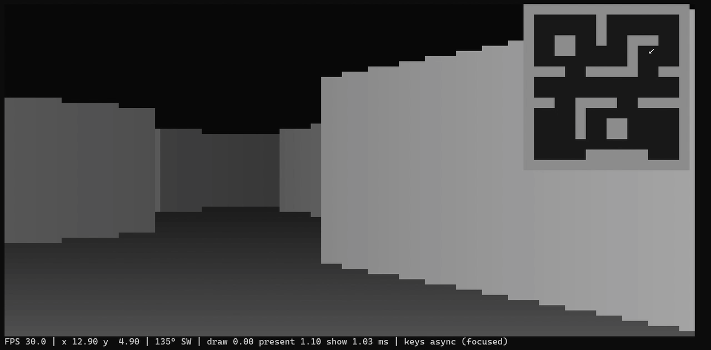

# termfps

A first-person shooter that runs entirely inside your terminal. A raycaster
draws the walls with half-block pixels (`▀`, two pixels per character cell),
so you get a retro 3D view with no GPU and no game client, from one small
binary.

It's a **single-player survival game**: four arenas, zombies and shooters
that keep coming and get tougher, limited ammo, sound, and saved best scores.
Multiplayer is planned later.

[](docs/termfps-demo.mp4)

▶ [Watch the 27-second demo](docs/termfps-demo.mp4) (MP4, 4.7 MB). It shows
the first prototype; a new demo of the survival game is planned.

## Requirements

- **Go 1.27.1 or newer** to build.
- **A truecolor terminal.** Windows Terminal is the main target. VS Code's
  terminal also works.
- **At least 80x24 characters.** Smaller windows show a "Terminal too small"
  message until you resize. About 120x40 looks best.
- **For sound:** speakers. On Linux, ALSA or PulseAudio. Without them the game
  runs silently and the menu says why.

> Half-block and mixed modes need a truecolor terminal and more bandwidth
> than plain text. Press `V` for shade-block or ASCII mode, which use plain
> characters and the terminal's own colors. Without truecolor, the game
> starts in ASCII. On a slow connection, Settings > Color threshold (4 or 8)
> roughly halves what half-block and mixed send, at a small cost in color
> detail.

## Build and run

Windows (PowerShell), from the project folder:

```powershell
go build -o termfps.exe .
.\termfps.exe
```

Linux and macOS should work too (`go build -o termfps . && ./termfps`); the
code builds there and is checked on Linux by CI, but it hasn't been played
there much yet.

## Controls

In the game:

| Key / mouse | Action |
|---|---|
| `W` / `↑` | Move forward |
| `S` / `↓` | Move back |
| `A` / `D` | Strafe left / right |
| `Q` / `←` | Turn left |
| `E` / `→` | Turn right |
| `Space` / left click | Shoot (hold for 3 shots per second) |
| `R` / right click | Reload (the gun also reloads by itself when empty) |
| `M` | Show / hide the minimap |
| `V` | Switch render mode: half-block → shade → ASCII → mixed |
| `Esc` | Pause |
| `Ctrl+C` | Quit right away, from anywhere |

In menus: `↑` / `↓` (or `W` / `S`) to select, `←` / `→` (or `A` / `D`) to
change a setting, `Enter` to choose, `Esc` to go back. You can also click
an item. There's no mouse-look: terminals can't capture the mouse. While the
game runs, the mouse belongs to the game, so selecting text in the terminal
needs Shift+drag in most terminals.

On Windows you can move and turn at the same time (the default `async` key
mode). See `-keys` below for other systems.

## Menus

- **Start:** Play, Select map, Settings, Quit.
- **Pause** (`Esc` in the game; the game freezes, dimmed behind the menu):
  Resume, Settings, Restart, Quit to menu.
- **Settings** take effect right away: render mode, mixed background
  brightness (0-100%, default 20%), color threshold (off by default), render
  scale (auto draws the 3D view at most 160 columns wide in big windows;
  full; half), FPS
  (30 or 60), minimap at start, wall textures, sound on/off, volume, key
  mode, pixel aspect, map unlocks (survive 5:00, survive 2:00, or all
  maps open), minimap fog of war (on: the minimap shows only what you've
  seen).
- **Game over:** your kills, time and tier, your best on that map, then Try
  again or Main menu.

## Saving

Settings and progress are saved automatically to `%AppData%\termfps\save.json`
on Windows (`~/.config/termfps/save.json` on Linux): unlocked maps, your best
kills, time and tier on each map, and your total kills. A run counts when you
die, restart, quit to the menu, or press `Ctrl+C`. There are no mid-game
saves.

If the save file is damaged, the game keeps it as `save.json.bad`, starts
with defaults, and says so in the menu.

## Maps

| Map | Size | What it's like |
|---|---|---|
| The Arena | 16x16 | Small rooms and corridors; the first map |
| The Warehouse | 32x32 | Rows of metal shelves with aisles between them |
| The Yard | 64x32 | Open ground, stone blocks, containers, one building with two doors |
| The Tunnel | 16x64 | A long zigzag corridor |

The first map is open. Survive **5 minutes** on the newest open map to unlock
the next one. On maps bigger than the screen allows, the minimap shows the
area around you and scrolls as you move.

## Playing

- **Zombies (green)** hunt you through the map. Each takes 3 hits. Up close
  they hit you for 7-10 HP per second.
- **Shooters (red)** keep their distance and shoot when they can see you
  (8 damage, less accurate from far away). Each takes 2 hits. Break line of
  sight to stay safe.
- More enemies keep coming, out of your sight. Every 20 kills or 4 minutes
  the **tier** goes up: enemies get tougher, faster and more frequent, and
  more of them are shooters. How long can you last?
- **Ammo:** 25 in the gun, 50 spare at the start. **Ammo boxes** (yellow, also
  a yellow dot on the minimap) appear every 20-40 seconds. Walk over one for
  +25 spare rounds (up to 125).
- **Red blocks** in the maps can be shot away.
- You heal 5 HP per second after 4 seconds without being hit.
- The screen edges flash red when you're hurt; enemies flash white when hit.
- **Sound:** gunshots, reloads, the empty click, enemy shots, getting hurt,
  pickups, tier-ups, and a groan when a new enemy arrives. All generated by
  the game, no sound files.

## The screen

- **3D view:** walls fade with distance, and north/south faces are drawn
  darker so corners stand out. Ceiling near black, floor brightening toward you.
  Four looks, switched with `V` or in Settings: half-block pixels (the
  default), shade blocks (`█▓▒░`), ASCII (`@%#&8*o+=~-:,.`), and mixed: ASCII
  characters in color on a dim fill of the same color.
- **Minimap** (top right): walls, floor, red blocks, ammo boxes, and an arrow
  showing where you are and which way you face.
- **HUD** (bottom line): health, ammo, kills, tier, time survived, facing
  angle and compass direction.
  If the window is wide enough, it also shows FPS, render mode, position,
  frame timings and the input mode.

## Options

Flags override the saved settings for that launch.

| Flag | Default | What it does |
|---|---|---|
| `-fps N` | `30` | Target frames per second (1-240) |
| `-keys async\|events` | `async` on Windows, `events` elsewhere | `async` reads real key state (Windows only, ignored while the window isn't focused). `events` uses terminal key events. Terminals that report key releases (Windows Terminal, kitty, Ghostty, foot, WezTerm outside Windows) give exact held keys, so moving and turning at the same time works; the HUD then shows `keys events (releases)`. Other terminals only repeat the last key pressed, so moving and turning at the same time may not work, and a quick tap turns and moves a little (about 25 degrees). |
| `-aspect X` | `1.0` | Pixel height / width (0.5-2.0). Change it if walls look squashed or stretched with your font. |
| `-textures=false` | on | Flat gray walls instead of brick, stone and metal textures. |

Example: `.\termfps.exe -fps 60 -aspect 0.9`

## Troubleshooting

- **"An Application Control policy has blocked this file" (Windows).** That's
  Windows Smart App Control blocking a freshly built, unsigned program, not a
  bug in the game. Restarting Windows has cleared it; turning Smart App
  Control off fixes it for good. Note that Windows can't turn Smart App
  Control back on without a reinstall.
- **Grays look banded.** The terminal is reducing colors. Use Windows
  Terminal, or another terminal with 24-bit color, or press `V` for ASCII.
- **"Sound unavailable" in the menu.** The game couldn't open an audio
  device; the message says why. Everything else works.
- **The terminal looks broken after a crash.** It shouldn't: the game
  restores the terminal on exit and on crashes. If you ever see it, please
  open an issue with the printed error.

## Roadmap

The prototype (P0) and the single-player survival game (P1) are built.
Planned next (details in [PRD.md](PRD.md) and [TASKS.md](TASKS.md)):

1. **Maps and gameplay update:** better, more realistic maps and more to do
   in them (being discussed).
2. **Server / client split** inside the game, needed for the next two.
3. **You vs an AI agent:** play against Claude Code, Codex, opencode or another CLI agent, in modes like hide and seek or a face-to-face duel.
4. **Multiplayer:** team deathmatch over LAN, then over SSH.

## Development

```powershell
go build ./...; if ($?) { go vet ./... }; if ($?) { gofmt -l . }; if ($?) { go test ./... }
go test -bench . ./internal/render   # DrawFrame and presenter timings
```

CI runs the same checks on Windows and Linux for every push.

Code layout:

| Path | What's there |
|---|---|
| `main.go` | Startup: flags, maps, save file, audio, terminal restore and crash handling |
| `internal/app` | Game loop, screens (menus, game, game over), saving and sound wiring |
| `internal/ui` | Menu model and drawing |
| `internal/world` | Map parsing, raycasting (DDA), collision, paths for enemies |
| `internal/game` | Player, weapon, enemies, spawner and tiers, pickups (no terminal code) |
| `internal/input` | Keys and mouse to game input, real key state on Windows |
| `internal/render` | Pixel frame, shading, textures, sprites, presenters (half-block, shade, ASCII, mixed), minimap, HUD |
| `internal/save` | `save.json` read and atomic write |
| `internal/audio` | Generated sound effects, played with oto |
| `internal/assets` | Pixel art (gun, sprites) and wall textures as text files |
| `maps/*.txt` | The four maps, built into the binary |

Map files start with a `; name: The Arena` line, then the grid: `#`
(brick), `%` (stone) and `&` (metal) for walls, `.` for floor, exactly one
`P` for the start, `T` for a red target block, and `Z` / `S` for zombies and
shooters that start in the map. The border must be all walls. The number at
the start of the file name sets the order in the map menu.

Design notes live in [PRD.md](PRD.md), [ARCHITECTURE.md](ARCHITECTURE.md) and
[DECISIONS.md](DECISIONS.md). Progress is in [TASKS.md](TASKS.md) and
[PROGRESS.md](PROGRESS.md).

Built with [tcell](https://github.com/gdamore/tcell) and, for sound,
[oto](https://github.com/ebitengine/oto). The mixed render mode is S0ra's
idea, from the "Mixed" style in their image-to-ASCII library
[libasciic](https://docs.rs/libasciic) (MIT); S0ra also reported the
events-mode input problems that P1-14 improves.
